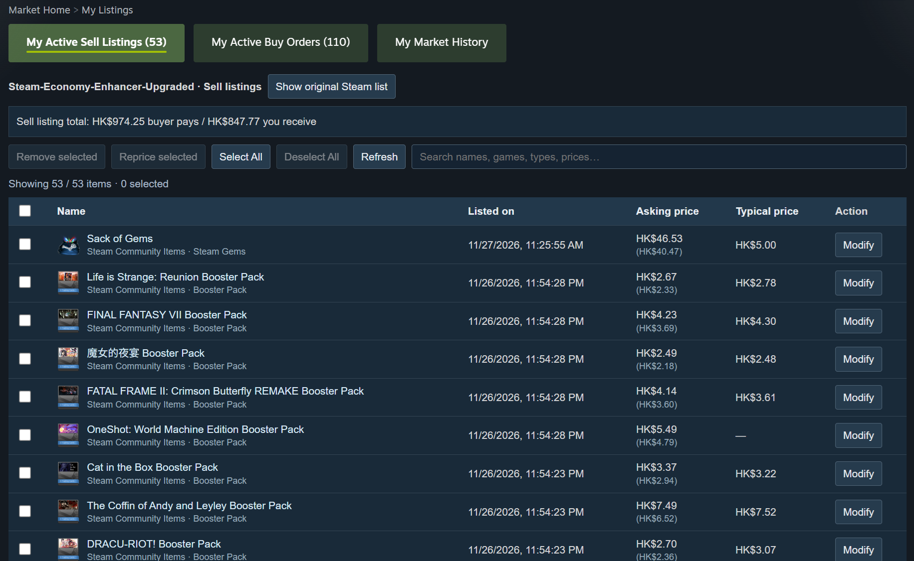

#  Steam Economy Enhancer

### Upgraded fork：新版 Steam 市场适配

此 fork 适配 React 版社区市场，保留旧版库存和报价页面的实现。

* [在售挂单](https://steamcommunity.com/market/activelistings)和[求购列表](https://steamcommunity.com/market/buyorders)改为无图片的紧凑表格。物品名称、上架时间（求购为剩余数量）、要价和通常价格均可点击表头切换升序、降序。
* 每行前有复选框。`Select All` 选择当前筛选结果，`Deselect All` 清空全部选择；筛选和排序不会丢失选择。批量取消会明确提示筛选隐藏的已选物品，逐项执行，遇到错误立即停止，不自动重试提交。
* 搜索覆盖名称、游戏、类型、物品说明、日期、数量和价格，例如 `Trading Card`、`Booster Pack`、`Steam`、`3.29`。列表先加载全部数据，搜索不限于首屏。
* 挂单保留“修改”入口，可以输入每件物品扣除手续费后的收入，调用 Steam 的 `UpdateSellListingPrice` 修改；需要手机或邮件确认时会提示。求购保留单项取消入口。
* [市场记录](https://steamcommunity.com/market/history)默认每页 **500 条**，支持页码、上一页/下一页、输入页码跳转，以及 25/50/100/500 条切换。改变每页条数时保留当前浏览位置。
* 保留“显示 Steam 原始列表”按钮。Steam 站内切换三个页面时自动重新挂载界面，不需要手动刷新。

2026-11-26 登录态只读实测：新版 `QueryMyHistory` 首屏请求 50 条成功，51/100/500 条返回 HTTP 400 / EResult 8；新版求购接口首屏 50 条成功，后续请求 50 条失败、25 条成功。兼容接口 `/market/myhistory/render/` 仍能一次返回 500 条，并可直接按偏移访问久远记录。因此历史分页使用兼容接口；它的日期按 Steam 原样展示，可能不含年份。若 Steam 将返回条数进一步缩减，脚本会按实际条数连续补齐一页，避免跳过记录。

通常价格以 Steam 返回的数据为准，未提供时显示 `—`。新版挂单查询失败时回退到兼容接口；兼容数据会尽量保留首屏已有的日期和通常价格。修改价格、下架和取消求购的真实账户操作未在开发测试中执行。

#### 安装与验证

1. 在 Edge 中安装或启用 [Violentmonkey](https://violentmonkey.github.io/)。
2. 使用下方此 fork 的安装链接，或在脚本管理器中用本项目 `code.user.js` 的完整内容更新现有脚本；确保只启用一份 SEE。
3. 刷新上面的 Steam 页面。只修改本地文件不会自动更新浏览器里已安装的脚本。

更新地址已指向此 fork，避免被上游旧版覆盖。

开发验证：Node.js 22.13 或 24+，运行 `npm install`、`npm test`。测试包含新版初始化、四列排序、全文搜索、跨筛选选择、接口分页/回退、批量操作失败处理、修改请求、500 条历史记录、任意页跳转、末页、限流重试和站内导航；测试使用合成数据，不读取账户 Cookie。

A free userscript to enhance your Steam Inventory, Steam Market and Steam Tradeoffers.

It adds the following features to the Steam Market:

*    Detect overpriced and underpriced items.
*    Select 5/25/all (overpriced) items and remove them at once.
*    (Automatically) relist overpriced items.
*    Sort and search items by name, price or date.
*    Total price for listings, as seller and buyer.

It adds the following features to the Steam Inventory:

*    Sell all (selected) items or trading cards automatically.
*    Select multiple items simultaneously with *Shift* or *Ctrl*.
*    Market sell and buy listings added to the item details.
*    Quick sell buttons to sell an item without confirmations.
*    Shows the lowest listed price for each item.
*    Turn selected items into gems.
*    Unpack selected booster packs.

It adds the following features to the Steam Tradeoffers:

*    A summary of all items from both parties that includes total number of items, number of unique items and item count breakdown (how many of each item there are)
*    Select all items of the current page.
*    Shows the lowest listed price for each inventory item.

The pricing can be based on the lowest listed price, the price history and your own minimum and maximum prices.
This can be defined in Steam Economy Enhancer's settings, which you can find at the top of the page near the *Install Steam* button.

> [!NOTE]  
> It is free but there is **NO** support. If you want to add functionality, feel free to submit a PR.

### Download

[Install Steam Economy Enhancer Upgraded](https://raw.githubusercontent.com/TinyKiecoo/Steam-Economy-Enhancer-Upgraded/master/code.user.js)

*[Violentmonkey](https://violentmonkey.github.io/) is required to install.*

### Screenshots

*Market*

*Inventory*

*Options*

*Trade offers*

### License

[MIT](LICENSE)
