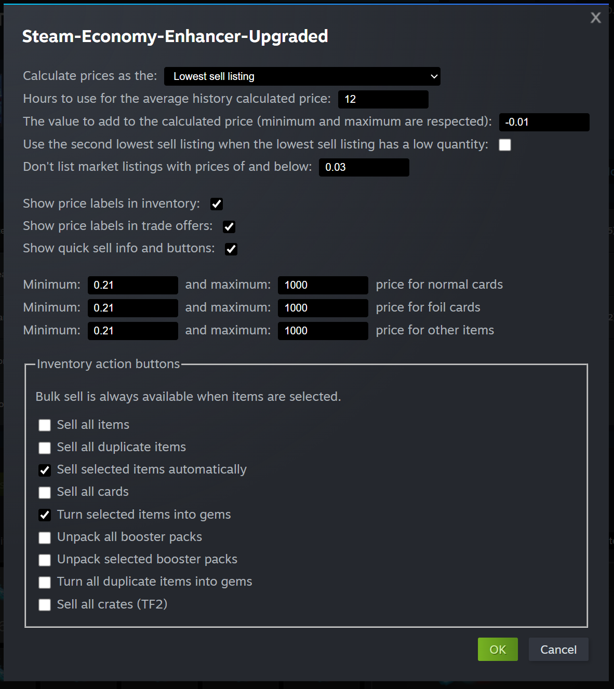

#  Steam-Economy-Enhancer-Upgraded

### Upgraded fork: the new Steam Market

This fork supports Steam's React market while retaining the legacy inventory and trade-offer implementation. All enhanced market controls, dialogs, messages and date formatting use English; item names and descriptions retain the text supplied by Steam.

* [Sell listings](https://steamcommunity.com/market/activelistings), [buy orders](https://steamcommunity.com/market/buyorders) and [market history](https://steamcommunity.com/market/history) use compact tables with **32 × 32 px item thumbnails**. Images fit within the existing row height and load lazily.
* Sell listings and buy orders support ascending/descending sorting by name, date (remaining quantity for buy orders), asking/bid price and typical price.
* Every order has a checkbox. `Select All` selects the matching items currently loaded; `Deselect All` clears every selection. Search, sorting and selection persist as new batches arrive.
* Results appear immediately from Steam's initial data, then update after each request. Subsequent buy-order requests load 25 items at a time. Searching and selecting already loaded items work while loading continues; cancellation and modification become available when loading completes.
* Search covers names, games, types, descriptions, dates, quantities and prices, including `Trading Card`, `Booster Pack`, `Steam` and `3.29`. Matching new items appear automatically as they arrive.
* Sell listings retain a `Modify` dialog for changing the amount received per item after fees, using Steam's `UpdateSellListingPrice` action. Mobile/email confirmation requirements are displayed. Buy orders retain individual cancellation controls.
* Bulk cancellation confirms any selections hidden by the current search, processes orders sequentially and stops on error without automatically retrying a submission.
* Market history defaults to **500 records per page**, with numbered pages, previous/next controls, direct page entry and 25/50/100/500 records per page. Changing page size preserves the current browsing position.
* History search supports an item-name substring, a start/end transaction date, or both. Either date bound can be omitted, and the name can be empty when a date is provided. Dates use the browser's local time and include the entire final day. `Start search` becomes `Stop search`; stopping aborts the current request and retains matches already found. Search results are paginated locally. `Clear search` restores normal history browsing.
* Name-only searches scan compatible batches of up to 500 records. Date searches use binary lookup over the timestamped history pages, then check exact transaction timestamps inside the selected interval. Steam requires exactly 50 records at offset zero and 25 for continuation requests, so date probes use whole pages and cache their results. A missing or rate-limited timestamp response stops the search instead of guessing years from abbreviated dates.
* `Show original Steam list` restores Steam's interface. Navigation between the three market sections automatically remounts the enhanced table.

Read-only checks on 2026-11-26 confirmed that the new history action accepts 50 records initially but rejects 51/100/500 with HTTP 400 / EResult 8. Buy orders accept 50 initially, then 25 on subsequent requests. The compatibility history endpoint `/market/myhistory/render/` still returns 500 records at once and supports direct offsets into older records. History pagination uses this endpoint; dates are displayed as supplied by Steam and may omit the year. If Steam reduces the number of records returned, the script fills each display page using actual batch lengths without skipping records.

Typical prices are shown when supplied by Steam, otherwise `—`. Failed new order queries fall back to the compatibility endpoint while retaining available metadata from batches already loaded. Development tests do not modify real prices, remove listings or cancel buy orders.

#### Installation and validation

1. Install or enable [Violentmonkey](https://violentmonkey.github.io/) in Edge.
2. Use this fork's installation link below, or replace the installed script with the complete contents of this project's `code.user.js`. Enable only one copy of SEE.
3. Refresh the Steam market page. Editing the cloned file does not automatically update the installed userscript.

Update URLs point to this fork.

Development: use Node.js 22.13 or 24+, then run `npm install` and `npm test`. Tests cover compact thumbnails, progressive loading, English controls, sorting, search, selection, pagination/fallback, submission failures, price-change requests, 500-row history pages, direct jumps, partial final pages, retry and navigation. Tests use synthetic data and do not read account cookies.

#### Attribution and license

Maintained by **TinyKiecoo**, based on [Steam Economy Enhancer by Nuklon](https://github.com/Nuklon/Steam-Economy-Enhancer). The fork remains under the [MIT license](LICENSE). The original copyright/permission notice is preserved, a separate notice covers the fork modifications, and the complete license also ships inside the installable userscript. MIT permits modification and distribution provided its required notices remain included; see the [Open Source Initiative's license text](https://opensource.org/license/mit).

The userscript name and namespace changed in v7.5.0. Disable the old `Steam Economy Enhancer` script and enable only `Steam-Economy-Enhancer-Upgraded` to avoid running both versions.

#### Changes in v7.6.1

Item-detail buy/sell order books keep Steam's original tables, headers, typography, colors and spacing. Expansion adds rows with the native row/cell markup and a bottom control, retaining five-level expansion and live updates. The generic script table theme no longer applies to these order books.

#### Changes in v7.6.0

- Sell listings show buyer-paid and seller-received totals. Buy orders show the commitment for their remaining quantities. Filtered and selected subtotals update with the table; different currencies remain separate.
- The **重新上架选中物品** action prepares a per-listing preview against the current lowest ask, using Steam's current fee and wallet rounding rules. Applying it calls `UpdateSellListingPrice` directly. It skips unchanged prices and pending confirmations, stops on a failed submission, and never cancels/recreates listings. Previews expire after one minute; Steam mobile/email confirmation may still be required.
- Item detail pages show five price levels per side initially. Each bottom button reveals five more, independently for buys and sells, retaining expansion across Steam's live updates. The script observes native order-book responses and makes one initial read, without adding a polling loop.
- Personal orders on item detail pages use the same compact tables, search, sorting, selection, totals, bulk cancellation and sell-price preview as the market overview. Only orders belonging to that item appear.
- Inventory **批量出售物品** retains Steam multisell behavior and stays visible. It is disabled without a selection, with the requested tooltip. Settings include individual visibility checkboxes for the other nine inventory action types, including game-specific actions. Hidden actions stay hidden when selection changes.

The requested button labels and disabled tooltip use Chinese; other script controls remain English. Select 5 / Select 25 are removed. Validation uses synthetic accounts, wallet rules and market data; no real listings were changed or cancelled.

#### Other market features: compatibility audit (updated 2026-11-27)

This audit combines source inspection with authenticated, read-only checks of the market home and item pages. Both use the new SSR UI and no longer expose the legacy listing tables, listing manager or settings anchor.

| Feature | Current status / evidence |
| --- | --- |
| Overpriced/underpriced detection and price colors | Unavailable: the old pricing worker depended on legacy listing rows; the new table displays Steam's supplied prices. |
| Reprice selected listings | Available in v7.6.0 using the native direct price-change action with a lowest-ask preview. |
| Select/reprice overpriced items automatically | Unavailable: automated pricing and overpriced detection have not been ported. |
| Select 5 / Select 25 | Removed as requested; Select All, Deselect All and individual selection remain. |
| Buyer/seller monetary totals for listings and buy orders | Available in v7.6.0, including quantities and separate currency groups. |
| Market settings shortcut near Install Steam | Unavailable: the old global-action-menu anchor is absent. The existing inventory settings entry remains. |
| Personal orders on item detail pages | Available in v7.6.0; the original Steam panel can be restored. |
| Expandable item order-book tables | Available in v7.6.0; each side expands by five price levels. |

The replaced legacy listing/history engine, its unused cancellation wrapper, market-only CSS and initialization paths have been deleted, together with its List.js, Luxon and checkboxes.js dependencies. Inventory multisell behavior is preserved with configurable action visibility. No real price changes, removals or cancellations were executed; live submission behavior is outside this read-only audit. Some live page/action reads returned HTTP 429 during the latest work; automated tests cover those failures and preserve the native order-book tables when the initial read fails.

A free userscript to enhance your Steam Inventory, Steam Market and Steam Tradeoffers.

The original upstream market features included the following (see the compatibility audit above for current support):

*    Detect overpriced and underpriced items.
*    Select multiple items and remove them at once.
*    (Automatically) relist overpriced items.
*    Sort and search items by name, price or date.
*    Total price for listings, as seller and buyer.

It adds the following features to the Steam Inventory:

*    Sell all (selected) items or trading cards automatically.
*    Select multiple items simultaneously with *Shift* or *Ctrl*.
*    Market sell and buy listings added to the item details.
*    Quick sell buttons to sell an item without confirmations.
*    Shows the lowest listed price for each item.
*    Turn selected items into gems.
*    Unpack selected booster packs.

It adds the following features to the Steam Tradeoffers:

*    A summary of all items from both parties that includes total number of items, number of unique items and item count breakdown (how many of each item there are)
*    Select all items of the current page.
*    Shows the lowest listed price for each inventory item.

The pricing can be based on the lowest listed price, the price history and your own minimum and maximum prices.
This can be defined in the existing inventory settings entry near the *Install Steam* button. The modern market settings shortcut has not yet been ported.

> [!NOTE]  
> It is free but there is **NO** support. If you want to add functionality, feel free to submit a PR.

### Download

[Install Steam Economy Enhancer Upgraded](https://raw.githubusercontent.com/TinyKiecoo/Steam-Economy-Enhancer-Upgraded/master/code.user.js)

*[Violentmonkey](https://violentmonkey.github.io/) is required to install.*

### Screenshots

*Market*

*Inventory*

*Options*

*Trade offers*

### License

[MIT](LICENSE)
